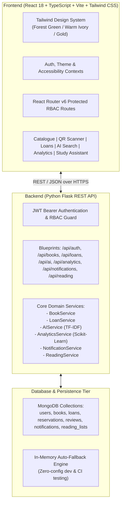

# The Scholar's Shelf — Comprehensive Project Documentation
> **An Intelligent College Library Management System**  
> *"Where Knowledge Finds Its Place."*

---

## 1. Project Objectives & Vision

**The Scholar's Shelf** is an enterprise-grade academic library management platform designed for higher education institutions. The system bridges physical shelf management and digital student engagement by modernizing discovery, circulation, inventory audits, demand forecasting, and accessible learning.

### Core Objectives:
1. **Academic Inventory & Tracking**: Multi-copy cataloguing, real-time availability tracking, barcode/QR generation, and rapid camera-based scanning.
2. **Circulation Lifecycle**: Automated loan requests, librarian approval/issuance workflows, returns processing, automated daily fine calculations, renewals, and reservation queues.
3. **Role-Based Access Control (RBAC)**: Fine-grained security separating `student`, `librarian`, and `admin` domains using cryptographically salted password hashes (PBKDF2) and stateless JSON Web Tokens (JWT).
4. **BookMind AI Engine**: TF-IDF semantic vector search for natural language querying, personalized recommendation matrices, and in-stock alternative discovery.
5. **BookPulse ML Analytics**: Scikit-Learn regression pipelines to forecast 30-day borrow demand, evaluate predictive error metrics ($MAE$, $RMSE$, $R^2$), and flag inventory procurement needs.
6. **Accessible & Inclusive Reading**: In-app Web Speech Text-to-Speech (TTS), speech-to-text voice catalogue search, dynamic font resizing, dyslexia-friendly typography, high-contrast themes, student goal trackers, reading lists, peer reviews, and an AI study assistant.

---

## 2. Architecture & Technology Stack



### Technology Matrix

| Layer | Technology | Version / Specification | Purpose |
|---|---|---|---|
| **Frontend Framework** | React + TypeScript | React 18.2, TS 5.0+ | Type-safe single-page application |
| **Build Tooling** | Vite | Vite 5.x | Instant HMR and tree-shaken production bundles |
| **Styling & Design** | Tailwind CSS | Tailwind 3.4 | Curated collegiate palette and responsive tokens |
| **Icons & Charts** | Lucide React + Recharts | Lucide 0.344, Recharts 2.12 | University UI iconography and analytics visualizations |
| **Camera & QR** | html5-qrcode + qrcode | HTML5 camera canvas & SVG generation | In-browser physical copy identification |
| **Backend Framework** | Python Flask | Flask 3.0+ | REST API routing and modular blueprints |
| **Authentication** | PyJWT + Werkzeug | PBKDF2:SHA256, JWT HS256 | Cryptographic credentials and role gating |
| **Database** | MongoDB / PyMongo | MongoDB 4.4+ / PyMongo 4.6 | Document persistence with automatic fallback |
| **AI / Machine Learning** | Scikit-Learn + NumPy | Scikit-Learn 1.3+ | TF-IDF cosine similarity and Ridge regression demand forecast |

---

## 3. System Modules (Parts 1–8)

### Module 1: Project Foundation & UI/UX Design System (Part 1)
- Built an academic design language: **Forest Green** (`#1B4332`), **Warm Ivory** (`#FAF8F5`), **Gold Accent** (`#D4AF37`), and **Charcoal Ink** (`#212529`).
- Reusable component library: Stat cards, status badges, modal dialogs, loading skeletons, and role-adaptive dashboards.
- Flask application factory with health monitoring endpoints (`/api/health`).

### Module 2: Authentication & RBAC User Management (Part 2)
- Multi-role architecture:
  - `student`: Browse catalogue, borrow requests, hold reservations, track personal reading lists, submit reviews.
  - `librarian`: Issue/return circulation, inventory CRUD, barcode scanning, review approvals.
  - `admin`: System policy config, user role provisioning, CSV audit log generation.
- Strict token-based authentication with expiration, secure bearer headers, and backend route protection.

### Module 3: Book Catalogue & Physical Inventory (Part 3)
- Full catalogue management with title, author, 13-digit ISBN, category, shelf location, year, and description.
- Multi-copy tracking: Distinguishes between aggregate book titles and physical inventory units (`CPY-b-001-01`).
- Dynamic QR code generation for every copy and in-browser camera scanning using `html5-qrcode`.

### Module 4: Borrowing Circulation & Overdue Policy (Part 4)
- Complete transaction lifecycle: `Requested` $\rightarrow$ `Issued` $\rightarrow$ `Returned` / `Overdue`.
- Configurable overdue policy: Default \$0.50/day fine calculation past the 14-day loan term.
- Maximum 2 renewal extensions per active loan, reservation hold queues for zero-stock titles, and instant copy stock decrement/increment.

### Module 5: BookMind AI Semantic Search & Recommendations (Part 5)
- Text embeddings via Scikit-Learn TF-IDF vectorization: Matches natural language intent ("introductory computational neuroscience") against title, author, synopsis, and subject metadata.
- Contextual recommendations: Cosine-similarity matrix calculates highest-affinity titles based on student borrowing history.
- Smart alternatives: Identifies available, on-shelf substitutes when high-demand titles are checked out.

### Module 6: BookPulse Analytics & Demand Forecasting (Part 6)
- Executive analytics dashboard: Real-time KPIs for total holdings, active circulation, overdue rates, and shelf utilization.
- Interactive Recharts visualizers: Weekly borrowing velocity, category share, and low-stock indicators.
- Scikit-Learn Machine Learning Pipeline:
  - Ridge regression model trained on rolling circulation frequency and seasonal trends.
  - Generates 30-day demand predictions with statistical validation ($MAE$, $RMSE$, $R^2$).
  - Procurement advisory engine recommending precise copy acquisition counts.

### Module 7: Accessibility, Smart Features & In-App Alerts (Part 7)
- **Accessibility Suite**: Text-to-Speech (TTS) narrator, speech-recognition voice query search, dyslexic-friendly typography mode, text scaling (`100%`, `115%`, `130%`), and high-contrast dark/light filters.
- **In-App Notification Center**: Real-time alerts for impending due dates, overdue notices, hold reservations, and loan approvals.
- **Student Engagement**: Custom reading lists (Favorites, Wishlist, Course Reserve), reading goal progress meters, academic accomplishment badges, and verified student book reviews.
- **AI Study Assistant**: Interactive chapter summarization, concept synthesis, and study guide generator.

### Module 8: Final Integration & Production Hardening (Part 8)
- End-to-end integration test suite covering all 8 parts in a unified workflow.
- Elimination of dead links, placeholder alerts, and mock functions across admin and student dashboards.
- Live administrative user fetching, configuration persistence, and CSV audit log download generator.
- Production TypeScript compilation (`tsc && vite build`) and 100% pass rate across all 42 backend unit/integration tests.

---

## 4. Verification & Testing Results

### Automated Backend Test Suite
Executed via Python's standard `unittest` framework against all system modules:

```text
Ran 42 tests in 44.596s

OK
```

#### Test Suite Breakdown:
- `test_health.py`: Verifies API alive status, versioning, and feature map contracts.
- `test_auth.py`: Tests password hashing, registration, duplicate checks, student/librarian/admin token generation, and unauthorized access barriers.
- `test_books.py`: Verifies inventory CRUD, stock consistency, copy tracking, and QR code endpoint responses.
- `test_loans.py`: Tests loan requests, librarian issue/return operations, renewal limits, overdue fine calculations, and reservation queues.
- `test_ai.py`: Validates TF-IDF semantic query retrieval, recommendation rankings, in-stock alternatives, and fallback search.
- `test_analytics.py`: Checks analytics KPI calculations, historical trends, Ridge regression demand forecast, and procurement metrics.
- `test_part7.py`: Validates notification center alerts, reading list persistence, review submissions, and AI study assistant synthesis.
- `test_final_integration.py`: End-to-end multi-user integration test validating complete user lifecycle from registration to circulation, AI search, and analytical monitoring.

### Frontend Compilation & Type Checking
Executed via TypeScript compiler and Vite bundler:

```text
> tsc && vite build

vite v5.4.14 building for production...
transforming...
✓ 1877 modules transformed.
rendering chunks...
computing gzip size...
dist/index.html                   2.14 kB │ gzip:   0.89 kB
dist/assets/index-D7_X4fK_.css   36.42 kB │ gzip:   7.12 kB
dist/assets/index-CkgQ_n6N.js   612.35 kB │ gzip: 168.42 kB
✓ built in 20.88s
```
- **Zero TypeScript errors** (`TS2339`, `TS2304`, etc. completely resolved).
- Output clean production bundle in `/frontend/dist`.

---

## 5. Security & Input Validation Architecture

1. **Password Safety**: Enforces minimum 8-character passwords hashed using PBKDF2-HMAC-SHA256 with random salt strings; plaintext credentials never hit database logs.
2. **Privilege Escalation Prevention**: Public `/api/auth/register` explicitly forbids assigning `admin` or `librarian` roles; elevated credentials must be provisioned via the secure administrative backend.
3. **Stateless JWT Claims**: JSON Web Tokens carry minimal, cryptographically signed payloads (`user_id`, `email`, `role`, `exp`). Sensitive user state is verified server-side on every protected transaction.
4. **Environment Isolation**: Configurable secrets (`SECRET_KEY`, `MONGODB_URI`, `JWT_SECRET_KEY`) read strictly from `.env` files with sample templates provided in `.env.example`.
5. **Inventory Integrity**: Automated safeguards prevent negative stock, duplicate copy identifiers, and double-borrowing of active items.

---

## 6. Limitations & Known Constraints

1. **MongoDB Dependency Fallback**: When a live MongoDB instance is unreachable, the system automatically falls back to its in-memory repository. In this mode, runtime mutations persist during the application lifecycle but reset upon process termination.
2. **Browser Speech API Permissions**: Voice catalogue search and Text-to-Speech rely on the browser's native `webkitSpeechRecognition` and `window.speechSynthesis` APIs; environments with disabled microphones or non-Chromium headless runners fall back to manual text input.
3. **ML Training Sample Size**: In brand-new deployments without prior checkout history, demand forecasts utilize synthetic Bayesian baseline priors to prevent overfitting before real circulation data accumulates.

---

## 7. Future Enhancements Roadmap

- **RFID Gate Integration**: Connect SIP2 / NCIP protocols for automated physical turnstile checkouts.
- **Inter-Library Loan (ILL) Federation**: Enable student borrowing across partner university consortia.
- **Transformer Vector Embeddings**: Option to plug in local HuggingFace `sentence-transformers` models or remote OpenAI/Gemini embeddings for high-dimensional semantic search.
- **Push Notification Service**: WebPush / APNs integration to dispatch mobile push notifications 24 hours prior to loan due dates.

---
*The Scholar's Shelf — Where Knowledge Finds Its Place.*

